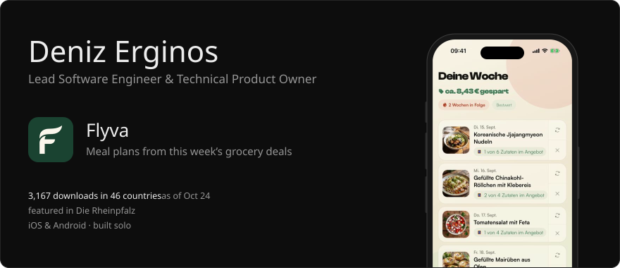
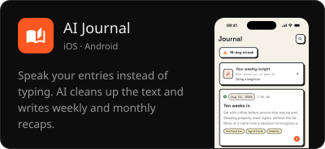
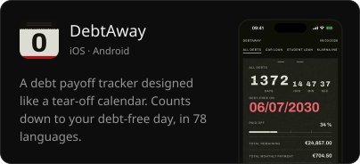
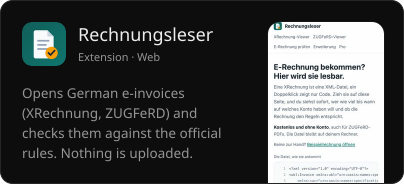
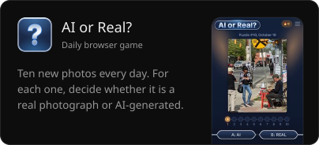

  
  
  
  

In my day job I work on medical software. I set the frontend architecture and dev stack for six squads and drive AI adoption across the company, from custom coding agents to self-healing CI/CD. That code lives in private repositories.

**Stack:** React, TypeScript, Next.js, TanStack, Angular, React Native and Expo, Flutter, Node.js, Hono, AWS, Cloudflare Workers, Docker, Jenkins, GitLab CI, Figma, Claude Code

[erginos.io](https://erginos.io) · [LinkedIn](https://www.linkedin.com/in/derginos) · Flyva on the [App Store](https://apps.apple.com/app/id6759984213) and [Google Play](https://play.google.com/store/apps/details?id=app.flyva)
